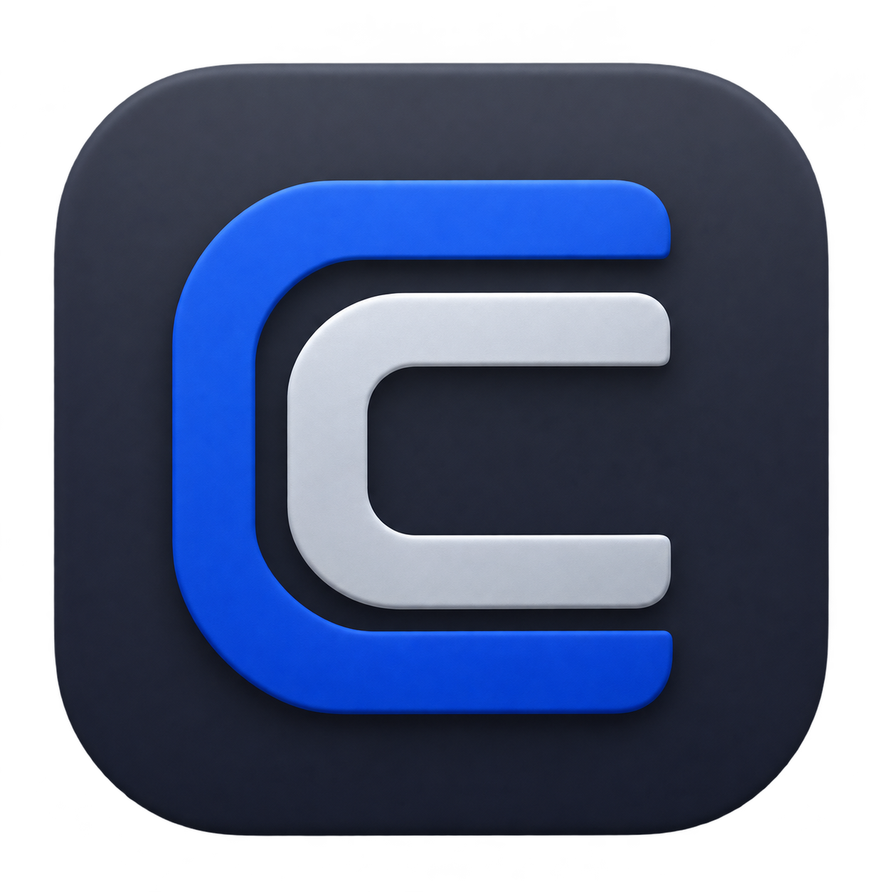

# CopySaver

A macOS-first, open source clipboard history and named-snippet utility designed to keep stored content encrypted locally.



**Community beta:** [Download CopySaver 0.1.5 Beta 1 for macOS](https://github.com/rafsuntaskin/copysaver/releases/download/v0.1.5-beta.1/CopySaver-0.1.5-beta.1-universal.dmg). Certificate-free app with encrypted local storage; see [release notes and checksums](https://github.com/rafsuntaskin/copysaver/releases/tag/v0.1.5-beta.1). Stable-release acceptance is unfinished. See [validation status](spec.md#0-delivery-checklist-and-progress).

## Install and use

Download the attached universal `.dmg` from the release, quit an older CopySaver, and drag the app into Applications. This build is ad-hoc signed and **not notarized by Apple**. macOS can require Privacy & Security approval; managed Macs may block it. Follow [installation/update instructions](docs/INSTALL.md) and verify the attached checksums. No Apple account or Terminal security bypass is required.

Targets macOS 14 or later, Apple silicon and Intel. Runtime verification on minimum macOS/Intel, clean-Mac upgrades, VoiceOver and widget discovery remains pending. Windows is not included.

Allow macOS clipboard access, copy new text, then press **Option-Command-V** to search and copy it. Paste with Command-V in the destination app. Change the shortcut or pause capture in Settings. See [troubleshooting](docs/TROUBLESHOOTING.md) if capture or opening fails.

## v0.1 scope

- Searchable plain-text clipboard history with pinning and automatic retention.
- Automatic website title/description/image previews, plus local email, phone, JSON and code views; exact original-text copying.
- Named snippets for addresses, signatures, and other reusable text.
- Sensitive snippets with hidden previews, explicit reveal, and private clipboard expiry.
- A full native library and a Spotlight-style Focus panel with a configurable global shortcut.
- Experimental small/medium launcher-widget source and bundle; gallery discovery in ad-hoc builds is unverified.
- An encrypted SQLite-backed vault with a random key kept separately in macOS Keychain.

The selected stack is Swift 6, SwiftUI, AppKit, CryptoKit, Security/LocalAuthentication, SQLite, and WidgetKit. macOS is the priority; Windows is a later, separately scoped client.

## Privacy design

Core capture, search, copy and storage work offline, without an account, server or telemetry. New community libraries capture automatically after OS clipboard approval, reopen after sleep, and respect saved Pause/Disable choices. Hide and pause clears the interface and stops capture until explicit reopening; it is not an authentication lock. Sensitive snippets conceal previews/search bodies and require no additional authentication in the open community library. Copying deliberately puts plaintext on the system clipboard. The selected non-sensitive website link automatically loads metadata and an image, exposing your IP and URL to that site/image host. Disable this in Settings → Privacy & Storage. Sensitive snippets are never fetched; preview data stays in memory. Open in browser remains explicit.

Community vault keys use the default login Keychain's calling-app ACL. Copied database files alone cannot reveal the contents; a compromised unlocked account or decryptable Keychain is outside this protection. No app-exclusivity or device-only guarantee is claimed for this profile. Portable backup/recovery is not included in v0.1, so keep another copy of important information. See [community installation/privacy notes](docs/COMMUNITY.txt) and [spec section 7](spec.md#7-security-model).

## Design

[Native library](designs/01-native-library.png) is the approved full window; [Focus panel](designs/02-focus-panel.png) is the approved quick-access view. The approved [Layered C icon](designs/icons/README.md) is used for the app and Library header. See [design notes](designs/README.md).

## Development

Start with [development setup](docs/development.md), [contribution workflow](CONTRIBUTING.md), and [repository agent instructions](AGENTS.md). The standalone Swift toolchain can build and test the core without modifying the system Xcode installation:

```sh
make build
make test
make preview
```

The preview opens the approved three-column library with synthetic samples. Use the sidebar’s Focus mode action to inspect the compact panel. Preview mode never creates a vault, accesses Keychain, or copies to the system clipboard.

The dependency-free Swift package includes AES-GCM encrypted SQLite storage, Keychain adapters, and SwiftUI/AppKit views. Automated tests use synthetic data and injected OS boundaries. `make app` builds an ad-hoc community development app at `.build/CopySaverDev.app`, with a separate identity/vault from the older protected Xcode build. `make preview` still uses fictional in-memory samples without capture or Keychain access. `make community-dmg` builds a universal app and embedded launcher widget from a reviewed clean checkout, with no Apple signing key or notarization. macOS may require first-run/update approval; actual widget discovery and clean-Mac release testing remain pending. The versioned beta bundle and draft workflow are documented in [releasing](docs/RELEASING.md). See [development setup](docs/development.md), [community release validation](docs/release-checklist.md#community-dmg), [native evidence](docs/native-integration.md), and the [vault format](docs/vault-format.md).

## Contributing and security

Use focused branches, Conventional Commits, and the spec checklist to track verified progress. See [CONTRIBUTING.md](CONTRIBUTING.md). Never attach real clipboard content, vaults, or credentials to issues. See [SECURITY.md](SECURITY.md) for the current reporting policy.

Licensed under [MIT](LICENSE).
