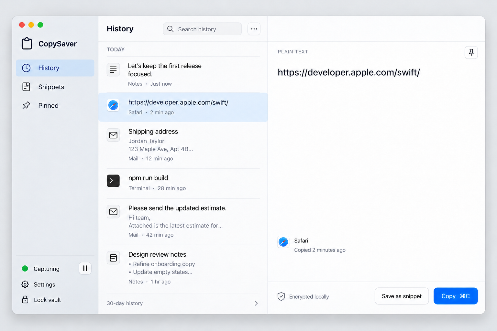
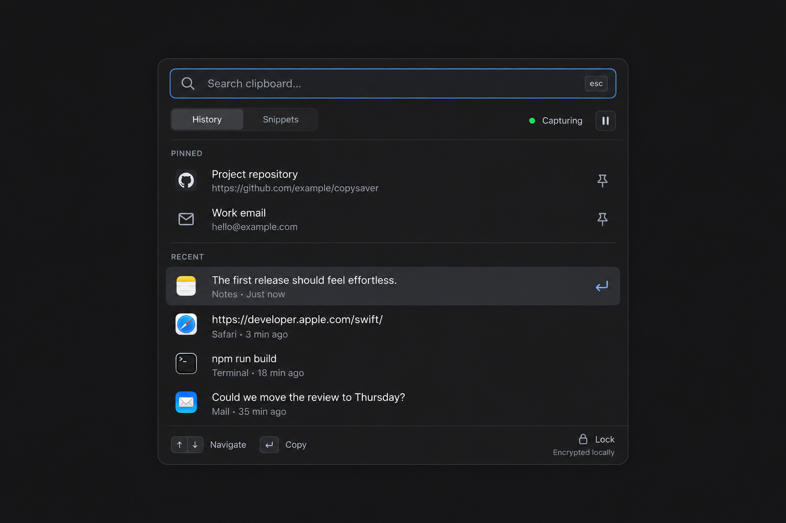
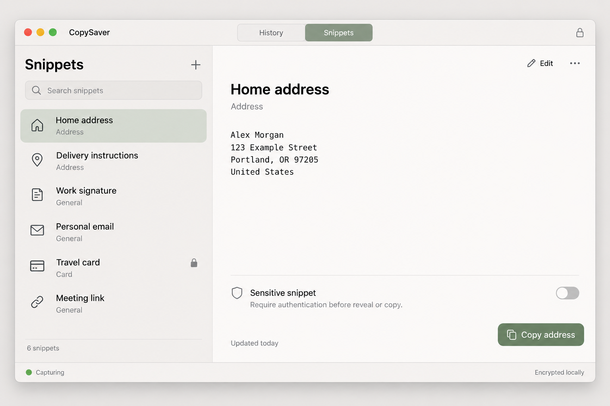

# CopySaver UI explorations

Three static concepts generated on October 26, 2026 using built-in image generation, based on `../spec.md`. The user selected concepts 1 and 2 as the implementation direction: Native library for the full window and Focus panel for global quick access. A SwiftUI/AppKit development scaffold now implements the selected structures; full interaction, accessibility, and security acceptance remain pending. All sample content is fictional.

## 1. Native library

Selected: full application window.

A familiar three-column macOS library: navigation, searchable history, and a generous text preview. Cool neutrals and a restrained blue accent. Best when browsing and managing a larger history.

## 2. Focus panel

Selected: Focus mode, accessible globally through a user-configurable keyboard shortcut while CopySaver is running.

A compact dark quick-access panel for keyboard-driven retrieval. Search, selection, source context, capture status, and copy hints stay within one small surface. This is a companion workflow rather than a replacement for library editing and settings.

## 3. Quiet snippets

Exploration only; not selected.

A simpler two-column layout with top-level History/Snippets navigation, warm neutrals, and a muted sage accent. More space for reusable text, clear editing controls, and an explicit sensitivity setting.

## Approved direction and interaction

Use Native library (1) for the full application window and Focus panel (2) for Focus mode. Apply a shared system-accent color, typography, and control vocabulary across both. Follow the system light/dark appearance by default, with explicit light/dark options. The light library and dark panel mockups show the selected structures in different appearances, not a requirement to force a different theme on each surface.

- The full window keeps the three-column shell for both History and Snippets: navigation, searchable list, and detail/editor pane. Pinned is a history filter; Settings and Lock vault remain accessible in the sidebar footer.
- Focus mode opens above the current workspace from any supported foreground app using a configurable global shortcut. Initial default: Option-Command-V. The app must be running; the full library can be closed.
- Settings → General → Focus Mode Shortcut provides recording, clearing, and restoring the default binding. Explain conflicts and retain the last valid binding if registration fails.
- Focus search immediately on open. Arrow keys navigate, Return copies and dismisses, Command-C copies without dismissal, and Escape or a second shortcut press dismisses. The user pastes into the destination app with Command-V.
- Provide Open Library in Focus mode and separate Open Focus Mode / Open Library menu bar actions. Carry an unlocked selection into the library when switching surfaces.
- Both surfaces share the vault and capture state. A locked focus panel displays only unlock controls, with no previous results, titles, or counts.

## Sidebar widget addition

Add a native macOS Notification Center widget, also usable on the desktop. The small size opens Focus mode; the medium size adds History and Snippets links. Keep it minimal and consistent with concepts 1 and 2. It uses static generic labels, without saved text, snippet names, item counts, or live vault/capture status. Links open the app and follow its normal unlock flow; the extension never accesses the clipboard, vault, or key. The source implementation follows this generic-label launcher layout; signed gallery/snapshot validation is pending. Full behavior and acceptance criteria are in spec section 4.5.

Refine the remaining states within this direction: snippet editing, masked sensitive snippet, hidden library, first run, permission denied, shortcut recording/conflicts, and empty/search-empty states. The November 4 community profile trusts the open user session: Sensitive conceals previews/search/accessibility output without fresh authentication. The protected compatibility profile retains its original authentication policy. Sidebar selection is distinct from contained hover, press and keyboard focus states; no scaling or sliding animation is used.

The native sample preview has been inspected in light and dark appearances, including library rows/details and the Focus panel. Implementation still needs full contrast, target size, keyboard, VoiceOver, reduced-motion, and global shortcut/Spaces tests. See [native integration evidence](../docs/native-integration.md). Generated screenshots do not establish accessibility compliance or working security behavior. Behavioral details and acceptance criteria are recorded in [spec.md](../spec.md).

Full generation prompts and the native-library refinement are preserved in [prompts.md](prompts.md).
